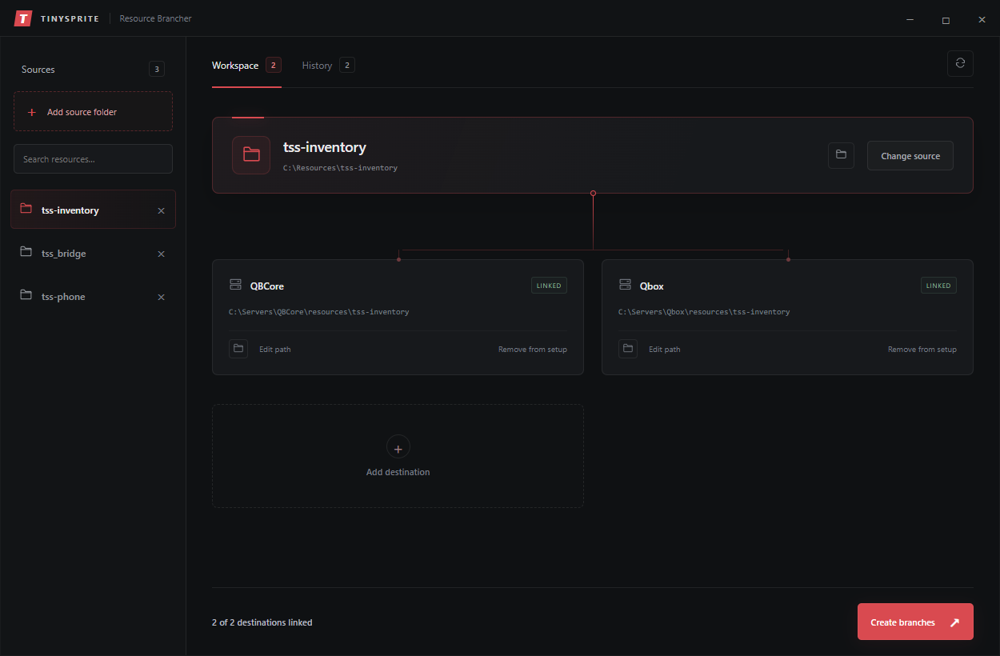
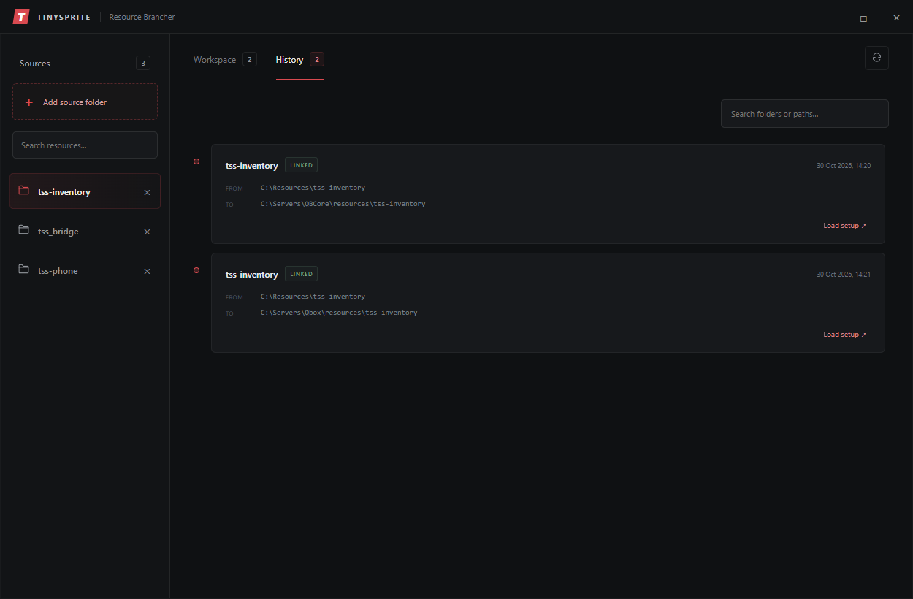

# Resource Brancher

A small Windows app for sharing one source folder across multiple locations. Useful for running the same FiveM resources on different development servers.

Resource Brancher creates **directory junctions**. Each destination points to your original folder, so edits made through any location affect the same files. Nothing is copied or synced. These are folder links, not Git branches.



## Start

You need Windows, Python 3.10 or newer added to PATH, and Microsoft Edge WebView2 Runtime.

1. Download and extract the app.
2. Double-click **Launch Resource Brancher.bat**.
3. On first launch, the launcher installs the Python interface package if needed. This requires an internet connection.

No UI build step is needed.

## Create branches

1. Click **Add source folder** and choose your original folder.
2. Click **Add destination** and choose a parent folder. The source folder's name is added automatically.
3. Repeat for any other locations.
4. Click **Create branches**.

For example, selecting `C:\Resources\my-resource` as the source and `C:\Servers\Test\resources` as the destination parent creates a link at `C:\Servers\Test\resources\my-resource`.

- Select a source in the sidebar to return to its saved setup. Use the search box to filter by name or path.
- Click **×** beside a source to remove its setup and history from the app. Its source folder and existing links stay in place.
- Click a folder icon to open that location in File Explorer.
- **Edit path** chooses a new parent folder while keeping the resource folder name. It updates the setup; it does not move an existing link.
- **Remove from setup** only removes the saved destination. It does not delete its link or files.

## History

The **History** tab shows recorded links across all your sources. Search by folder name or path, or click **Load setup** to return to a previous destination.



Use the refresh button to check links again:

| Status | Meaning |
| --- | --- |
| Linked | The destination points to the selected source. |
| Ready | The destination is available. Click **Create branches** to link it. |
| Blocked | The source is unavailable, the destination is occupied, or the path cannot be used. |

If you delete a link manually, it returns to **Ready** after refreshing. Links discovered in older saved setups have an unknown creation date; hover over their history date to see this.

## Keep in mind

- Existing folders and links pointing elsewhere are never overwritten.
- Changes and deletions inside a branch also affect the original source. Configuration files are shared too.
- Keep your source folder in place. Moving or deleting it breaks its links.
- Use local drives that support junctions. Network shares are not supported.
- Restart your FiveM resources as usual after code changes.

## Saved data

Sources, destinations and history are stored in `settings.json` beside the app. It is created when you save a setup and is excluded by `.gitignore`.

Before sharing a ZIP, leave out `settings.json`, settings backups, setup reports and error logs. `.gitignore` only affects Git uploads.

## Tests

```console
python -m unittest -v test_brancher
```
